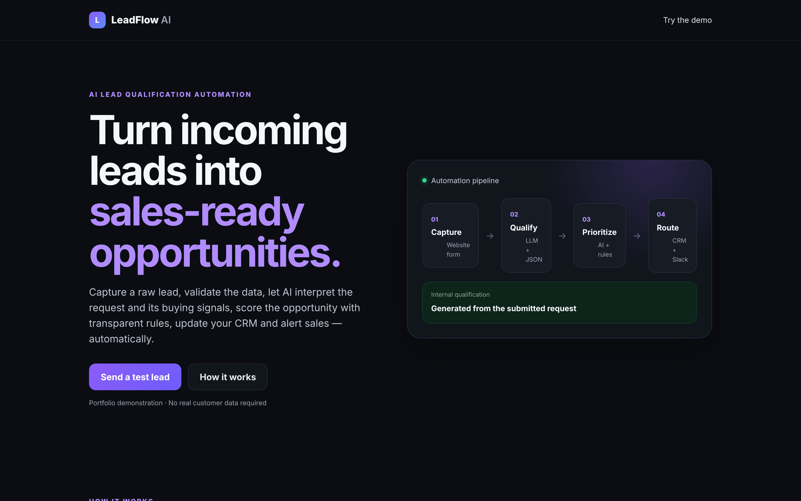
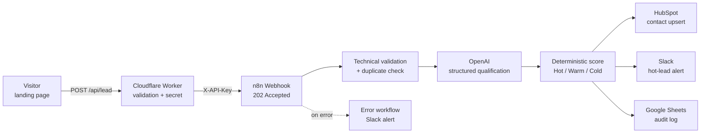

# LeadFlow AI — AI lead qualification with n8n, OpenAI and HubSpot

[](https://github.com/Denis88818/leadflow-ai/actions/workflows/test.yml)


A website lead form that qualifies every request with AI before it reaches your sales team.
A visitor writes their request in their own words; an n8n workflow extracts budget, timing and intent with OpenAI, scores the lead 0–100, creates or updates the contact in HubSpot, pings Slack for hot leads and keeps an audit log in Google Sheets.



## What it does

1. **Capture** – a lightweight landing page collects name, email, company and one free‑form message (plus a honeypot and consent).
2. **Protect** – a Cloudflare Worker validates the request and forwards it to n8n. The n8n API key lives only in the Worker; the browser never sees it.
3. **Acknowledge fast** – n8n replies `202 Accepted` immediately, then processes the lead asynchronously.
4. **Qualify** – OpenAI reads the message and returns structured JSON: requirement, budget signal, urgency, fit, intent, pain points and what information is missing. It never invents data.
5. **Score** – a deterministic rule set (not the LLM) turns the AI signals into a 0–100 score: Hot ≥ 70, Warm 40–69, Cold < 40.
6. **Route** – the contact is upserted in HubSpot with the AI fields, hot leads trigger a Slack alert, and every submission is logged to Google Sheets.
7. **Fail loudly** – a separate error workflow posts any failed execution to Slack, so no lead is silently dropped.

## Architecture



## Design decisions

- **The secret never reaches the browser.** The page posts to its own origin (`/api/lead`); only the Worker adds the `X-API-Key` header.
- **The Worker fails closed.** It rejects cross-origin calls, non-JSON bodies, payloads over 32 KB and any webhook URL that is not on the host/path allowlist. Upstream calls time out after 20 s and every request gets a traceable ID.
- **AI interprets, rules decide.** The LLM extracts signals; the score is calculated by transparent rules, so results are explainable and stable.
- **Privacy by default.** The LLM receives only business context (company, source, message), not the person's name, email or phone.
- **Outcome-blind UI.** The visitor never sees the internal score, CRM response or error details.

## Repository layout

```
├── public/            Landing page (HTML, CSS, vanilla JS)
├── src/index.js       Cloudflare Worker: /api/lead and /api/health
├── n8n/               Importable n8n workflows (credentials removed)
│   ├── lead-intake-ai-qualification.json
│   └── lead-intake-error-alerts.json
├── test/              Worker tests (node:test)
└── wrangler.jsonc     Worker configuration
```

## Run it yourself

**Requirements:** Node.js 20+, a Cloudflare account, an n8n instance, plus OpenAI, HubSpot, Slack and Google Sheets credentials in n8n.

### 1. n8n

1. Import both files from `n8n/` (*Workflows → Import from file*).
2. Create credentials and select them in the nodes marked `REPLACE_ME`:
   - **Header Auth** for the Webhook node (`X-API-Key` + a long random value)
   - OpenAI, HubSpot (private app token), Slack, Google Sheets
3. Replace `PASTE_GOOGLE_SHEET_ID` with your sheet ID and adjust the Slack channels.
   In HubSpot, create the contact properties `ai_lead_score`, `ai_lead_class`, `ai_budget_signal`, `ai_urgency`, `ai_next_action` and `ai_summary`.
4. In the main workflow settings, set the *Error workflow* to **Lead Intake — Error Alerts**, then activate both workflows.

### 2. Worker and landing page

```bash
npm install
cp .dev.vars.example .dev.vars        # put the same X-API-Key value here
# edit wrangler.jsonc: N8N_WEBHOOK_URL and N8N_ALLOWED_HOSTS
npm run dev                            # local preview on http://localhost:8787
npm test                               # run the Worker tests
npx wrangler secret put N8N_WEBHOOK_KEY
npm run deploy
```

Check `GET /api/health`, send a test lead from the page and watch it appear in n8n executions, HubSpot and Slack.

## Example AI output

```json
{
  "qualification_status": "qualified",
  "requirement": "n8n workflow connecting website leads to HubSpot with Slack alerts",
  "budget_signal": "high",
  "urgency": "high",
  "fit": 9,
  "intent": 9,
  "pain_points": ["website leads are copied into the CRM by hand"],
  "next_action": "Call within 24 hours and send a fixed-price proposal",
  "missing_information": ["preferred implementation start date"],
  "score": 95,
  "lead_class": "Hot"
}
```

Score = fit × 3 + intent × 2 + budget points (0–25) + urgency points (5–25). If the AI response is missing or malformed, the lead is saved as **Needs review** instead of being lost.

## Tech stack

n8n · OpenAI API · HubSpot CRM API · Slack · Google Sheets · Cloudflare Workers · vanilla JavaScript · node:test · GitHub Actions

## Author

Built by **Denis Danchenko** — AI automation and CRM developer (n8n, HubSpot, AI agents, web apps).
Available for projects on [Upwork](https://www.upwork.com/freelancers/~016707bca373f53f65).

## License

[MIT](LICENSE)
